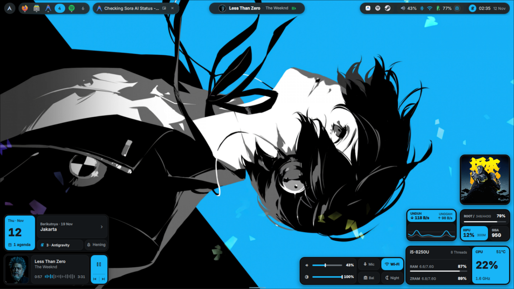
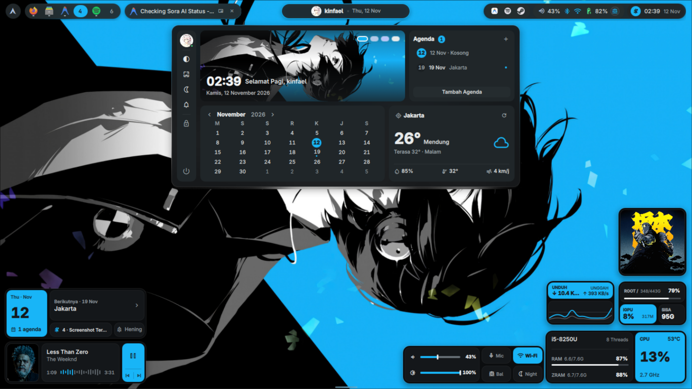

<div align="center">

# Sora (空)

**A sleek, minimalist Material You desktop shell for Hyprland built with [Quickshell](https://quickshell.outfoxxed.me/).**

[](https://github.com/Reze-1214/quickshell-sora)
[](LICENSE)
[](https://git.outfoxxed.me/quickshell/quickshell)
[](https://github.com/hyprwm/Hyprland)

<br/>

### Desktop Overview


<br/>

### Center Island & Dashboard


</div>

---

## Highlights & Features

- **Ultra-Slim Floating Top Bar**: Compact 38px floating bar with 30px pill modules to maximize usable screen estate without visual clutter.
- **Unified Center Island**: An interactive 3-page sliding capsule in the center of the bar:
  - **Page 1**: Profile card, date summary, and greeting.
  - **Page 2**: Live MPRIS media player with track title, artist, and play/pause controls.
  - **Page 3**: System hardware telemetry (CPU, RAM, and thermals).
  - *Interaction*: Simply scroll up/down over the capsule to switch pages instantly, or click to open the full Control Center.
- **Comprehensive Control Center (Dashboard)**:
  - Header profile banner with personalized greeting and quick status.
  - Interactive monthly calendar with daily event markings and agenda notes.
  - Live weather forecast showing temperature, conditions, and wind speed.
  - Hardware quick toggles: Wi-Fi drawer, Bluetooth panel, Dark/Light mode switch, and Power controls.
- **Dynamic Island Toast Notifications**:
  - Floats seamlessly beneath the top bar with adaptive width (*hug-content* 168px - 304px).
  - Clean 2-line visual hierarchy with subtle wallpaper-derived Material You accents.
  - Non-intrusive dismiss button that appears smoothly on hover.
- **Modular Desktop Widgets**:
  - **Pulse Health**: Real-time radial and progress meters for CPU, RAM, and thermals.
  - **Network Telemetry**: Live download/upload bandwidth monitors and network graph.
  - **Media Wave**: Animated audio visualizer bars synced to active media playback.
  - **Photo Frame**: Customizable on-desktop polaroid frame.
  - **Sun Phase & Date**: Day/night solar cycle display with date card.
- **Material You Dynamic Theming**: Automatic color extraction from wallpapers via `matugen`, paired with a color-lock engine ensuring vibrant accents stay identical across both Dark and Light modes.

---

## Manual Installation

### Dependencies

#### Core Shell
- [quickshell-git](https://git.outfoxxed.me/quickshell/quickshell) (Desktop shell toolkit for Qt6)
- [hyprland](https://github.com/hyprwm/Hyprland) (Wayland compositor)
- [matugen](https://github.com/InioX/matugen) (Material You color palette generation)

#### System Utilities & Services
- [pipewire](https://github.com/PipeWire/pipewire) / [wireplumber](https://gitlab.freedesktop.org/pipewire/wireplumber) (`wpctl` for audio & mic volume/mute)
- [brightnessctl](https://github.com/Hummer12007/brightnessctl) (Screen brightness controls)
- [networkmanager](https://gitlab.freedesktop.org/NetworkManager/NetworkManager) (`nmcli` for Wi-Fi & network status)
- [bluez](https://git.kernel.org/pub/scm/bluetooth/bluez.git) & `bluez-utils` (`bluetoothctl` for Bluetooth devices)
- [playerctl](https://github.com/altdesktop/playerctl) (MPRIS media playback & metadata)
- [grim](https://gitlab.freedesktop.org/emersion/grim) (Wayland screen capture)
- [slurp](https://gitlab.freedesktop.org/emersion/slurp) (Interactive region selector)
- [wl-clipboard](https://github.com/bugaevc/wl-clipboard) (`wl-copy` for clipboard management)
- [wf-recorder](https://github.com/ammen99/wf-recorder) (Screen recording utility)
- [jq](https://github.com/jqlang/jq) (Command-line JSON parser)
- [zenity](https://gitlab.gnome.org/GNOME/zenity) (File and folder chooser dialogs)
- [libcanberra](https://git.0pointer.net/libcanberra.git) (Shutter sound effect on screenshot)
- [lm_sensors](https://github.com/lm-sensors/lm-sensors) (`sensors` for CPU thermal telemetry)
- `python` (Standard Python 3 library for local state serialization)

#### Qt6 Runtime & Libraries
- `qt6-base`
- `qt6-declarative`
- `qt6-imageformats`
- `qt6-multimedia`
- `qt6-shadertools` (Qt Shader Baker `qsb` for transition shaders)

#### Typography & Icon Fonts
- [ttf-material-symbols-variable](https://github.com/google/material-design-icons) (Google Material Symbols Outlined)
- [inter-font](https://github.com/rsms/inter) (atau `ttf-inter` untuk UI typography)
- [ttf-jetbrains-mono-nerd](https://github.com/ryanoasis/nerd-fonts) (Monospace & hardware telemetry)

---

### Arch Linux / CachyOS (One-Liner Install)

Install all official dependencies with `pacman`:

```bash
sudo pacman -S --needed \
    hyprland \
    pipewire \
    wireplumber \
    networkmanager \
    bluez \
    bluez-utils \
    brightnessctl \
    playerctl \
    grim \
    slurp \
    wl-clipboard \
    wf-recorder \
    jq \
    zenity \
    libcanberra \
    lm_sensors \
    python \
    qt6-base \
    qt6-declarative \
    qt6-imageformats \
    qt6-multimedia \
    qt6-shadertools \
    inter-font \
    ttf-jetbrains-mono-nerd
```

Install AUR dependencies with `paru` or `yay`:

```bash
yay -S --needed quickshell-git matugen-bin ttf-material-symbols-variable
```

---

### Setup Instructions

1. **Clone the repository** into your Quickshell configuration path:
   ```bash
   git clone https://github.com/Reze-1214/quickshell-sora.git ~/.config/quickshell/sora
   ```

2. **Test run with Quickshell**:
   ```bash
   quickshell -c sora
   ```

3. **Auto-start on Hyprland**:
   Add the following line to your `~/.config/hypr/hyprland.conf`:
   ```ini
   exec-once = quickshell -c sora -n
   ```

---

## Key Shortcuts & Interactions

| Action | Interaction |
| :--- | :--- |
| **Open Control Center / Dashboard** | Left-click the Clock pill (or click Center Island) |
| **Toggle Do Not Disturb (DND)** | Right-click the Clock pill |
| **Toggle Bluetooth Power** | Right-click the Bluetooth icon in the top bar |
| **Cycle Center Island Pages** | Scroll wheel up / down over the Center Island |
| **Toggle Light / Dark Mode** | Right-click desktop -> Select Mode Terang / Mode Gelap |
| **Change Wallpaper & Accent** | Open Dashboard -> Wallpaper Studio or Accent Picker |
| **Toggle Desktop Widgets** | Right-click desktop -> Widget Manager |

---

## Roadmap (`v0.1.x` -> `v0.2.0`)

- [x] Floating ultra-slim bar with hardware status cluster
- [x] Unified 3-page Center Island with smooth scroll switching
- [x] Comprehensive Control Center (Calendar, Weather, Hardware toggles)
- [x] Dynamic island toast notifications with adaptive width
- [x] Material You wallpaper extraction & consistent accent lock
- [x] Modular desktop widgets (Pulse Health, Network, Media Wave, Sun Phase)
- [ ] Multi-monitor independent bar configuration
- [ ] Customizable widget positioning persistence via UI drag
- [ ] Additional quick toggle integrations (Night Light, VPN)

---

## License

This project is licensed under the [MIT License](LICENSE) - Copyright (c) 2026 Reze-1214.
