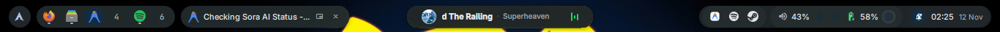
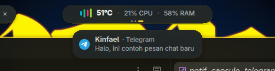
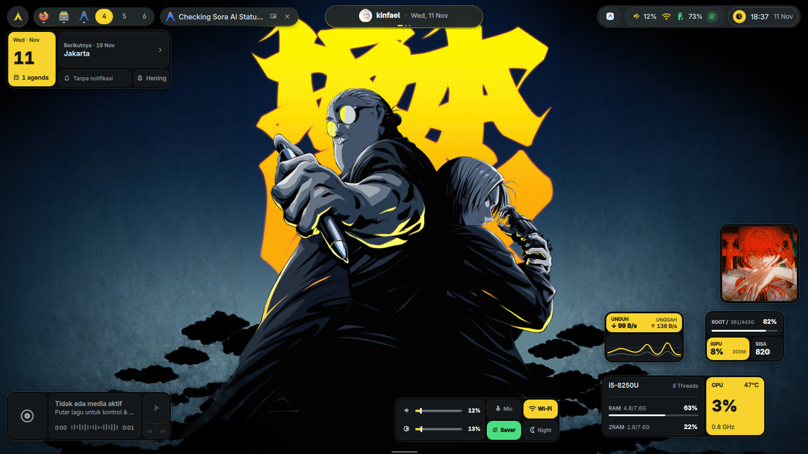

# Sora (空) `v0.1.0-alpha`

> **Status: Work in Progress (Alpha)**  
> Sora is currently in active development. Features, layout refinements, and documentation are continuously evolving.

A sleek, minimalist, Material You desktop shell for Hyprland built with [Quickshell](https://quickshell.outfoxxed.me/).


---

## Visual Tour & Key Modules

### 1. Ultra-Slim Floating Top Bar
A compact 38px bar with 30px pill modules designed to maximize usable screen estate without visual clutter:



- **Left Section (Workspaces)**: Dynamic workspace indicator showing active workspace index, with a toggleable Kanji numeral mode (一, 二, 三...) and current active window title pill.
- **Center Section (Unified Island)**: A 3-page interactive sliding capsule:
  - *Page 1*: Quick profile card and date summary.
  - *Page 2*: Live MPRIS media controls (play/pause, track title, artist).
  - *Page 3*: System hardware telemetry (CPU, RAM, and temperature meters).
  - *Interaction*: Simply scroll up/down over the capsule to switch pages instantly.
- **Right Section (Status Cluster)**:
  - Live Bluetooth indicator showing connected device name (click to open panel, right-click to toggle adapter power).
  - Network status indicator with Wi-Fi signal strength.
  - Privacy Microphone Mute badge (lights up when microphone is muted).
  - Clock pill with Do Not Disturb (DND) status badge (right-click to toggle DND).

---

### 2. Dynamic Island Toast Notifications
A notification toast floating directly beneath the center island:



- **Adaptive Width**: Intelligently hugs content from 168px up to 304px, preventing oversized empty bubbles.
- **Clean Hierarchy**: 2-line layout prioritizing the application title and message preview.
- **Wallpaper-Derived Styling**: Subtle 1px outline using dynamic Material You accents extracted from your current wallpaper.
- **Non-Intrusive Controls**: Dismiss button appears gracefully on mouse hover to keep the interface pristine during normal viewing.

---

### 3. Modular Desktop Widgets
A collection of lightweight, non-intrusive widgets that sit directly on your wallpaper:



- **Pulse Health Widget**: Compact radial or bar meters for live CPU, memory, and thermal telemetry.
- **Network Telemetry**: Real-time download/upload speed monitoring with link quality indicators.
- **Media Wave**: Animated audio visualizer bars synced to active media playback.
- **Photo Frame**: Customizable on-desktop polaroid/photo frame that defaults to matching your active wallpaper or personal photo.
- **Sun Phase & Weather**: Day/night solar cycle display combined with local weather conditions and temperature.

---

## Manual Installation

### Dependencies

#### Core Shell
- [quickshell-git](https://git.outfoxxed.me/quickshell/quickshell) (Desktop shell toolkit for Qt6)
- [hyprland](https://github.com/hyprwm/Hyprland) (Wayland compositor)
- [matugen](https://github.com/InioX/matugen) (Material You color generation)

#### System Utilities & Services
- [pipewire](https://github.com/PipeWire/pipewire) / [wireplumber](https://gitlab.freedesktop.org/pipewire/wireplumber) (`wpctl` for audio & mic volume/mute)
- [brightnessctl](https://github.com/Hummer12007/brightnessctl) (Screen brightness controls)
- [networkmanager](https://gitlab.freedesktop.org/NetworkManager/NetworkManager) (`nmcli` for Wi-Fi & network status)
- [bluez](https://git.kernel.org/pub/scm/bluetooth/bluez.git) & `bluez-utils` (`bluetoothctl` for device connections)
- [playerctl](https://github.com/altdesktop/playerctl) (MPRIS media playback & metadata)
- [grim](https://gitlab.freedesktop.org/emersion/grim) (Wayland screen grabber)
- [slurp](https://gitlab.freedesktop.org/emersion/slurp) (Region selector for screenshot & recording)
- [wl-clipboard](https://github.com/bugaevc/wl-clipboard) (`wl-copy` for clipboard management)
- [wf-recorder](https://github.com/ammen99/wf-recorder) (Screen recording utility)
- [jq](https://github.com/jqlang/jq) (Command-line JSON processor)
- [zenity](https://gitlab.gnome.org/GNOME/zenity) (File and folder chooser dialogs)
- [libcanberra](https://git.0pointer.net/libcanberra.git) (Shutter sound on screenshot)
- [lm_sensors](https://github.com/lm-sensors/lm-sensors) (`sensors` for CPU thermal telemetry)
- `python` (Standard Python 3 library for local state serialization)

#### Qt6 Runtime & Libraries
- `qt6-base`
- `qt6-declarative`
- `qt6-imageformats`
- `qt6-multimedia`
- `qt6-shadertools` (Shader baker `qsb` for transition shaders)

#### Typography & Icon Fonts
- [ttf-material-symbols-variable](https://github.com/google/material-design-icons) (Google Material Symbols Outlined)
- [inter-font](https://github.com/rsms/inter) (atau `ttf-inter` untuk UI typography)
- [ttf-jetbrains-mono-nerd](https://github.com/ryanoasis/nerd-fonts) (Monospace & hardware telemetry)

---

### Arch Linux / CachyOS (One-Liner Install)

Install all official dependencies with `pacman`:

```bash
sudo pacman -S --needed \
    hyprland \
    pipewire \
    wireplumber \
    networkmanager \
    bluez \
    bluez-utils \
    brightnessctl \
    playerctl \
    grim \
    slurp \
    wl-clipboard \
    wf-recorder \
    jq \
    zenity \
    libcanberra \
    lm_sensors \
    python \
    qt6-base \
    qt6-declarative \
    qt6-imageformats \
    qt6-multimedia \
    qt6-shadertools \
    inter-font \
    ttf-jetbrains-mono-nerd
```

Install AUR dependencies with `paru` or `yay`:

```bash
yay -S --needed quickshell-git matugen-bin ttf-material-symbols-variable
```

---

### Setup Instructions

1. **Clone the repository** into your Quickshell configuration path:
   ```bash
   git clone https://github.com/Reze-1214/quickshell-sora.git ~/.config/quickshell/sora
   ```

2. **Test run with Quickshell**:
   ```bash
   quickshell -c sora
   ```

3. **Auto-start on Hyprland**:
   Add the following line to your `~/.config/hypr/hyprland.conf`:
   ```ini
   exec-once = quickshell -c sora -n
   ```

---

## Key Shortcuts & Interactions

| Action | Interaction |
| :--- | :--- |
| **Open Control Center / Dashboard** | Left-click the Clock pill (or top-right cluster) |
| **Toggle Do Not Disturb (DND)** | Right-click the Clock pill |
| **Toggle Bluetooth Power** | Right-click the Bluetooth icon in the top bar |
| **Cycle Center Island Pages** | Scroll wheel up / down over the Center Island |
| **Toggle Light / Dark Mode** | Right-click desktop -> Select Mode Terang / Mode Gelap |
| **Change Wallpaper & Accent** | Open Dashboard -> Wallpaper Studio or Accent Picker |
| **Toggle Desktop Widgets** | Right-click desktop -> Widget Manager |

---

## Roadmap (`v0.1.x` - `v0.2.0`)

- [x] Floating ultra-slim bar with hardware status cluster
- [x] Dynamic island toast notifications with adaptive width
- [x] Material You wallpaper extraction & consistent accent lock
- [x] Modular desktop widgets (Pulse Health, Network, Media Wave, Sun Phase)
- [ ] Multi-monitor independent bar configuration
- [ ] Customizable widget positioning persistence via UI drag
- [ ] Additional quick toggle integrations (Night Light, VPN)

---

## License

This project is licensed under the [MIT License](LICENSE) - Copyright (c) 2026 Reze-1214.
